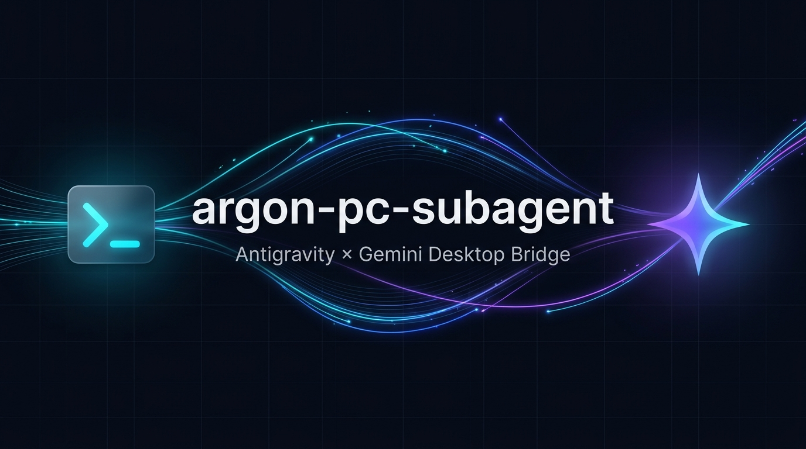
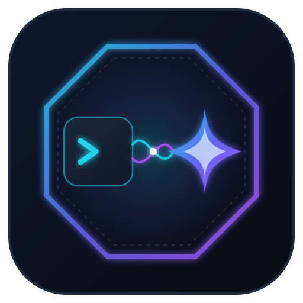
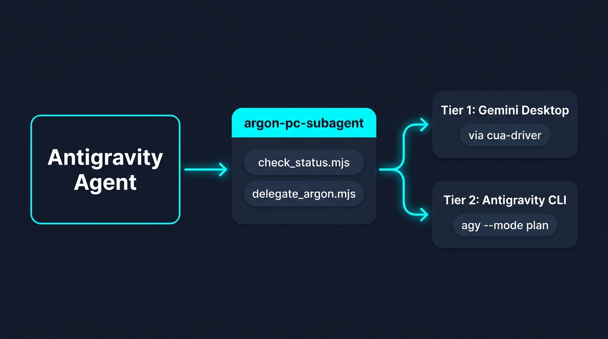
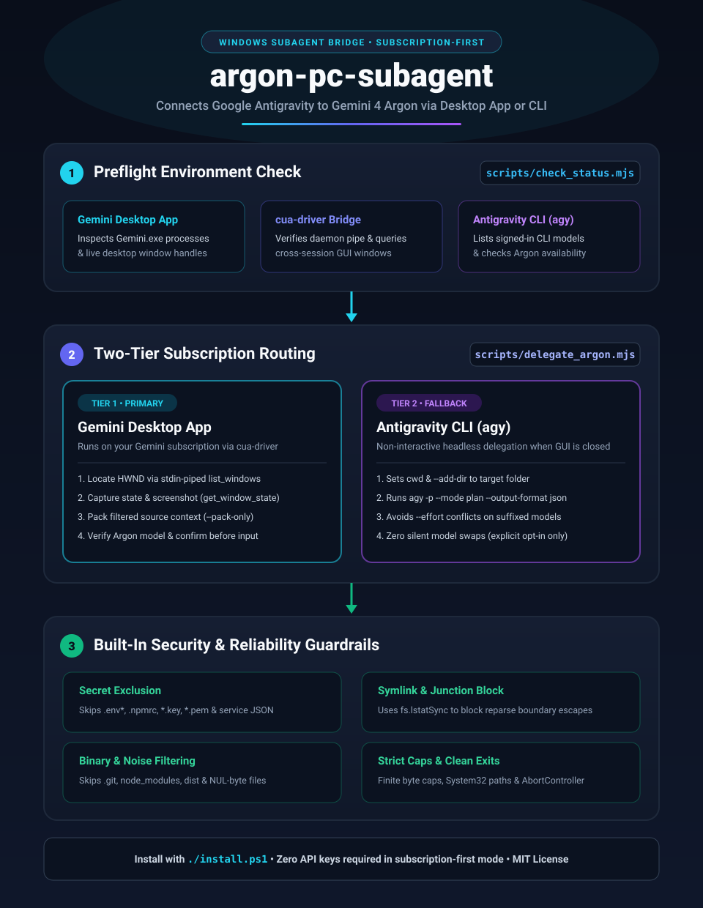

<p align="center">
  
</p>

<p align="center">
  
</p>

<h1 align="center">argon-pc-subagent</h1>

<p align="center">
  <strong>Subscription-first Windows bridge connecting Google Antigravity with Gemini 4 Argon via the Gemini Desktop App (<code>cua-driver</code>) and Antigravity CLI (<code>agy</code>).</strong>
</p>

---

## Overview

`argon-pc-subagent` is an agent skill and Node.js utility suite for Windows that lets Antigravity inspect your Gemini desktop environment and delegate code reviews, security audits, or deep reasoning tasks using your existing Gemini / Antigravity subscriptions—without requiring an external API key by default.

## Architecture

### Simplistic Architecture

<p align="center">
  
</p>

### Full Workflow & Security Infographic

<p align="center">
  
</p>

---

## How It Works

1. **Preflight Check ([`scripts/check_status.mjs`](scripts/check_status.mjs))**
   - Inspects Windows `Gemini.exe` / `GeminiAppLauncher.exe` processes.
   - Checks whether the `cua-driver` daemon is running and queries live desktop windows (`cua-driver call list_windows '{"app":"Gemini"}'`).
   - Queries `agy models` to report available CLI models and whether `gemini-4-argon` is exposed on your signed-in account.

2. **Two-Tier Subscription Routing ([`scripts/delegate_argon.mjs`](scripts/delegate_argon.mjs) & [`SKILL.md`](SKILL.md))**
   - **Tier 1 — Gemini Desktop App (`cua-driver`):** When `Gemini.exe` has an open window and the `cua-driver` daemon is running, uses `cua-driver` (stdin-piped JSON for PowerShell 5.1 compatibility) to capture the window screenshot, pack secret-filtered context (`--pack-only`), verify the Argon model selector, and delegate with user foreground confirmation.
   - **Tier 2 — Antigravity CLI (`agy`):** Headless delegation using `agy -p ... --mode plan --output-format json` with `cwd` and `--add-dir` scoped to the target directory. Never silently substitutes models (`--allow-agy-fallback-model` must be passed explicitly if `gemini-4-argon` is unavailable in `agy models`).

3. **Security Guardrails**
   - **Secret exclusion:** Automatically skips `.env*`, `.npmrc`, `.netrc`, `.pypirc`, `.htpasswd`, `.git-credentials`, `*.pem`, `*.key`, `*.p12`, `*.pfx`, `*.jks`, `*.keystore`, `*.ppk`, `*.kdbx`, `id_rsa`/`id_ed25519`/`id_ecdsa`/`id_dsa`, `credentials.json`, and `service-account*.json`/`client_secret*.json` (including via `--prompt-file`).
   - **Symlink/junction containment:** Uses `fs.lstatSync` to skip symbolic links and NTFS junctions so directory packing cannot escape the target boundary.
   - **Binary & noise skipping:** Skips `.git`, `node_modules`, `dist`, `build`, `out`, `target`, binary extensions, and NUL-byte buffers.
   - **Finite context caps:** Validates `--max-context-bytes` numerically before enforcing byte budgets.

---

## Prerequisites (Windows)

- **Node.js 20+** (uses built-in `fetch`, `node:fs`, `node:child_process`; zero npm dependencies)
- **Gemini Desktop App** (`Gemini.exe`) and/or **Antigravity CLI** (`agy`)
- **`cua-driver`** (required only for Tier 1 GUI automation)

---

## Installation

Clone the repository and run [`install.ps1`](install.ps1) in PowerShell to install the skill into both `~/.agents/skills/argon-pc-subagent` and `~/.gemini/config/skills/argon-pc-subagent`:

```powershell
git clone https://github.com/DevvGwardo/argon-pc-subagent.git
cd argon-pc-subagent
.\install.ps1
```

To install into a single project's `.agents/skills/` folder instead:

```powershell
.\install.ps1 -ProjectOnly -ProjectRoot "C:\path\to\your\project"
```

### Enabling the Tier 1 Desktop Bridge (`cua-driver`)

Run once in a normal interactive Windows PowerShell window so `cua-driver` runs in your logged-in desktop session:

```powershell
cua-driver autostart enable
cua-driver autostart kick
'{"app":"Gemini"}' | cua-driver call list_windows
```

---

## Usage

### 1. Check Local Status

```powershell
node scripts/check_status.mjs
```

*(Pass `--check-api` only if you explicitly want to test an optional `GEMINI_API_KEY`.)*

### 2. Pack Context or Dry-Run Delegation

```powershell
# Preview packed non-secret files and skipped files
node scripts/delegate_argon.mjs --prompt "Security audit" --target src --pack-only --json

# Dry-run routing preview with explicit CLI fallback model
node scripts/delegate_argon.mjs --prompt "Security audit" --target src --thinking high --allow-agy-fallback-model gemini-3.8-flash-high --dry-run
```

### 3. Example Antigravity Prompt

> "Use the `argon-pc-subagent` skill to check if my Gemini PC app is running and delegate a security audit of `src/` to Argon at high thinking level."

---

## Repository Structure

```text
argon-pc-subagent/
├── SKILL.md                      # Antigravity skill instructions & routing policy
├── install.ps1                   # Windows installer for global or project skill dirs
├── scripts/
│   ├── check_status.mjs          # Preflight detector (Gemini Desktop, cua-driver, agy)
│   └── delegate_argon.mjs        # Context packer, secret filter & CLI/API runner
├── assets/
│   ├── brand-banner.jpg          # Repository hero banner
│   ├── brand-logo.svg            # Repository emblem
│   ├── architecture-simple.jpg   # Simplistic architecture diagram
│   └── infographic.svg           # Full workflow & security infographic
├── LICENSE                       # MIT License
└── README.md
```

## License

[MIT](LICENSE)
